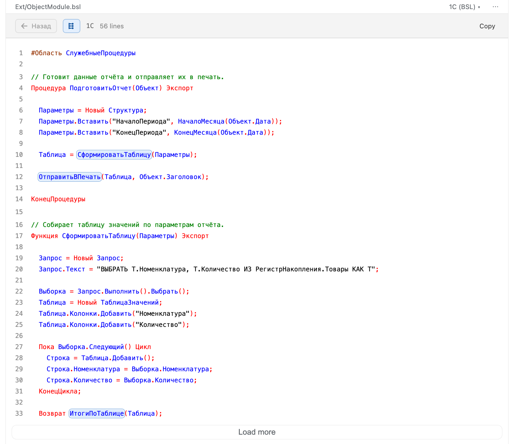
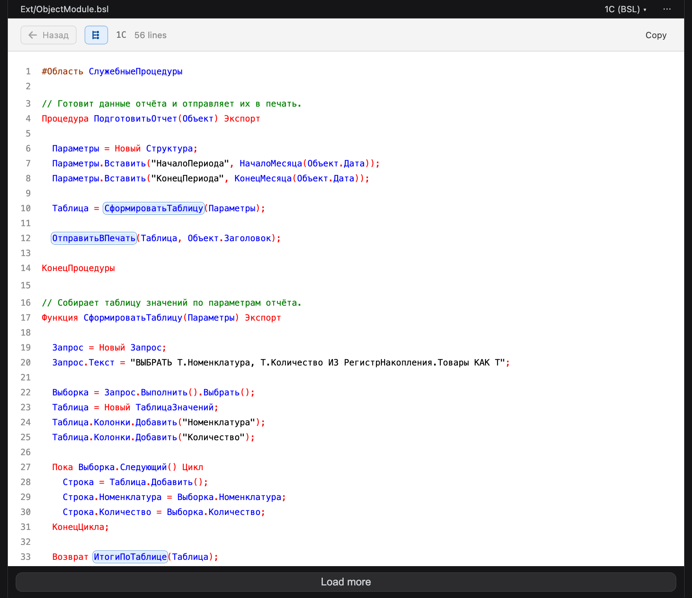
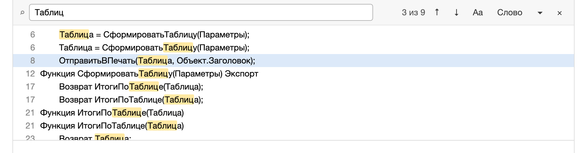
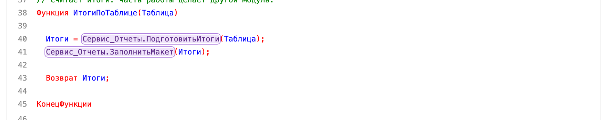
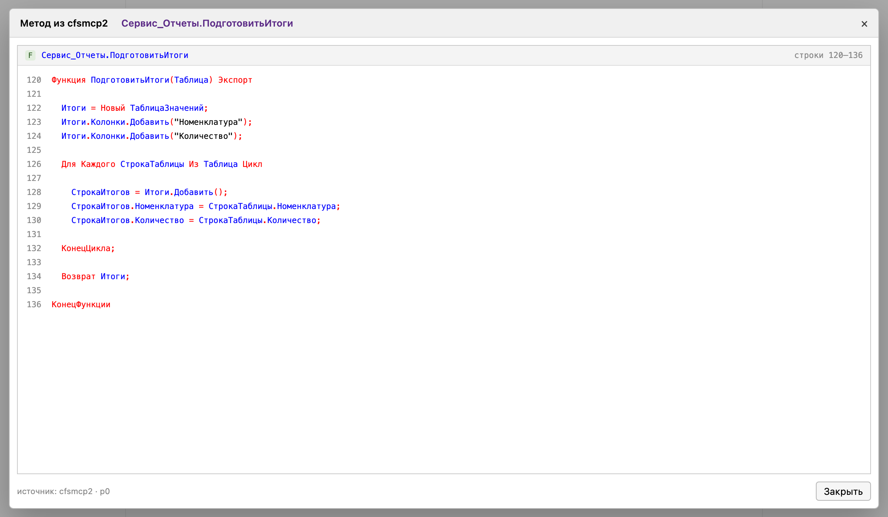
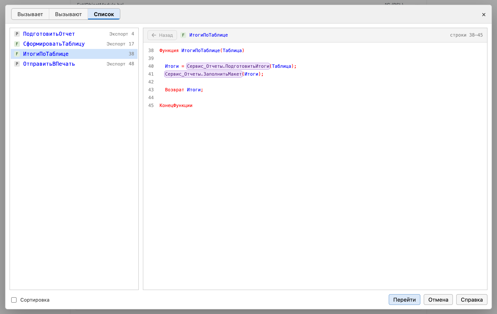

# BSL Lens — подсветка и навигация по коду 1С в dsh


Подсветка синтаксиса 1С:Предприятие (BSL) для просмотрщика файлов в dsh: откройте
`*.bsl` в боковой панели — файл отрисуется с номерами строк и раскрашенными
токенами вместо монотонного текста.





Вызовы методов этого модуля обведены в тексте **лёгкой синей рамкой**: клик по
такой рамке переносит к объявлению функции, а кнопка **«Назад»** в левом верхнем углу
возвращает туда, откуда кликнули (например, из `ПодготовитьОтчет` — в
`СформироватьТаблицу` и обратно). То же работает и в обеих формах навигации — списке и
дереве: рамки стоят в их правой панели, а «Назад» — в левом верхнем углу формы.

В шапке страницы — номера строк, копирование и две кнопки слева: **«Назад»** и
**«Методы»** — одна кнопка навигации, за которой стоят три вкладки: **«Вызывает»**
(дерево того, что вызывает метод), **«Вызывают»** (дерево тех, кто вызывает его) и
последняя — **«Список»** (плоский перечень всех методов модуля).

Подсветка повторяет **стандартную схему Конфигуратора 1С** (ключевые слова и
операторы красные, идентификаторы синие, комментарии зелёные, директивы
препроцессора коричневые, константы чёрные) и **всегда рисуется на белом фоне**,
даже если во всём приложении включена тёмная тема — см. [палитра](#палитра-конфигуратора).

Плагин — отдельный bundle для профиля `desktop`/`web`, ничего не патчит в
установленном dsh и не требует сборки: `client.js` — готовый браузерный бандл,
зависимостей у пакета нет. Поставить его может кто угодно по
[инструкции ниже](#установка); внешний просмотр методов (фиолетовые рамки) — это
экспериментальная часть, она работает только рядом с cfsmcp2 и без него молча
отключается.

## Что делает

Регистрирует в реестре предпросмотра документов (`ctx.documentPreviews`)
собственную реализацию для расширений `.bsl` и `.1c`:

| поле | значение | смысл |
|---|---|---|
| `extensions` | `['bsl', '1c']` | какие файлы обслуживает |
| `title` | `1C (BSL)` | имя в списке рендереров вкладки |
| `loading` | `text-pages` | текст читается постранично через общий reader |
| `wrap` | `true` | в тулбаре вкладки появляется переключатель переноса |

Тот же `id` занимает тело в keyed-слоте `sidebar.right.tab.document`, поэтому
рендерер выбирается автоматически при открытии `.bsl` и виден в выпадающем
списке рендереров.

Палитра и фон заданы литералами и не зависят от темы приложения: код
рисуется светлой страницей при любом оформлении (подробности и обоснование —
[ниже](#палитра-конфигуратора)).

## Требования

- **dsh** с профилем, где смонтирован `ui-sidebar-documentpreview` (он входит в
  composition `dsh-web-app`, то есть в обычную desktop/web-поставку). Без него
  клиентская часть просто не активируется, остальной профиль грузится как обычно.
- **Node.js** `^22.19 || >=24` — для самого плагина (это же ограничение у dsh).
- **Никаких зависимостей** ставить не нужно: `client.js` — готовый браузерный бандл,
  хост-половина использует только `node:` и `fetch`; установка — это `pnpm add` из
  GitHub и включение строки, сборки нет.
- **Необязательно: cfsmcp2** — только для просмотра методов других модулей
  (`Модуль.Метод()`). Без него всё остальное работает; окно честно скажет, что мост
  не отвечает.

## Установка

Плагин ставится **прямо из GitHub** — ни клонировать, ни собирать ничего не нужно:
пакет состоит из готового браузерного бандла и одного файла хост-половины.

### Через интерфейс (проще всего)

1. Боковая панель → **Plugins** → **Add plugin**.
2. Вставить адрес репозитория:

   ```
   github:askred-dot-ru/dsh-bsl-lens
   ```

   (понимается и `https://github.com/askred-dot-ru/dsh-bsl-lens.git`, и путь к
   локальному клону, если он у вас есть).
3. **Install** → дождаться pnpm → **Enable now** — эта кнопка сама включает строку в
   профиле, вручную править `package.json` не нужно.
4. Перезапустить dsh: строки Loader читаются при старте процесса.

### Через CLI

```sh
dsh plugin --profile desktop add github:askred-dot-ru/dsh-bsl-lens
# затем включить bundle: в ~/.dsh/profiles/desktop/package.json добавить
# "dsh-bsl-lens" в dsh.profile.bundles — `plugin add` только ставит зависимость
pnpm install            # в каталоге профиля, если правили package.json руками
```

Если есть локальный клон, вместо адреса GitHub можно указать путь:
`dsh plugin --profile desktop add "$PWD"` (pnpm превратит его в `link:`).

Профильный `package.json` после установки:

```json
{
  "dependencies": {
    "dsh-bsl-lens": "link:/путь/к/клону/dsh-bsl-lens"
  },
  "dsh": {
    "profile": {
      "bundles": [
        "@deepseek-ai/dsh-base",
        "@deepseek-ai/dsh-web-app",
        "dsh-bsl-lens"
      ]
    }
  }
}
```

### Проверка и откат

- `Plugins` показывает карточку **dsh-bsl-lens** (в списке строк — `bsl-lens`);
  открытие `.bsl` даёт вкладку «1C (BSL)» с подсветкой.
- Компонент **Обновить** в карточке плагина: плагины из Git не обновляются сами —
  обновление это переустановка более новой версии.
- Откат: выключить строку в карточке плагина (или убрать `"dsh-bsl-lens"` из
  `dsh.profile.bundles` и `dependencies`), затем `pnpm install` в каталоге профиля и
  перезапуск dsh.

### Настройка строки

Строка плагина принимает необязательные поля (в `cordis.patch.yml` профиля или в
карточке плагина):

```yaml
- insert:
    - id: bsl-lens
      name: 'dsh-bsl-lens'
      config:
        mcpPort: 8600        # порт cfsmcp2, если он не 8559
        # mcpHost: 127.0.0.1 # хост, если cfsmcp2 не на этой машине
        # mcpUrl: http://127.0.0.1:8559/mcp/  # или весь адрес целиком
        context: p0          # контекст выгрузки, если он не p0
```

- **Порт** задаётся одним полем: `mcpPort: 8600` (числом или строкой);
  `mcpHost` — если сервер на другой машине; `mcpPort: '10.0.0.5:8600'` — короткая
  запись «хост:порт»; `mcpUrl` — полный адрес, он главнее остальных.
- Адрес нормализуется: `localhost:9000`, `…:9000/mcp`, `…:9000/mcp/` сводятся к
  `http://localhost:9000/mcp/`. Кривой порт (не число, вне 1–65535) молча
  откатывается на `8559`, чтобы опечатка не ломала плагин.
- `context` — контекст выгрузки cfsmcp2 (по умолчанию `p0`), его знает только
  хост-половина; страница его не передаёт.
- Всё это нужно только внешнему просмотру: без cfsmcp2 страница, список, деревья и
  «Назад» работают как обычно.

### Откат

```sh
# убрать "dsh-bsl-lens" из dsh.profile.bundles и dependencies, затем
cd ~/.dsh/profiles/desktop && pnpm install
```

## Как это устроено

Штатный подсветчик dsh (`@deepseek-ai/dsh-client-ui-primitives`) — это singleton
Shiki с **фиксированным allowlist грамматик**: `LANG_ALIASES` и `LAZY_GRAMMARS`
приватны модулю, а его namespace в браузерной таблице модулей заморожен
(`Object.freeze`), так что добавить грамматику снаружи нельзя. Грамматики 1С в
Shiki тоже нет. Поэтому плагин приносит свой сканер (`tokenizeBsl`, ~350 строк,
без зависимостей) и рисует токены инлайн-стилями по палитре Конфигуратора.

Сканер понимает:

- комментарии `//` и строки `"…"` с удвоением `""`, в том числе многострочные с
  продолжением `|`;
- литералы даты `'20240101120000'`, числа `1.5`, `1e-3`;
- директивы препроцессора `#Область` / `#Если` / `#КонецОбласти`;
- аннотации `&НаКлиенте`, `&НаСервере`, `&Вместо`, `&ИзменениеИКонтроль`;
- ключевые слова в русском и английском написании, регистронезависимо;
- константы `Истина` / `Ложь` / `Неопределено` / `Null`;
- типы метаданных (`СправочникСсылка`, `ДокументОбъект`, `РегистрНакопленияНаборЗаписей`),
  коллекции (`Справочники`, `Документы`, `РегистрыСведений`);
- вызовы (`Имя(`) и обращения к членам (`Объект.Метод`) — причём `Запрос.Выполнить()`
  остаётся методом, хотя `Выполнить` — ключевое слово.

Тело предпросмотра отдаёт владельцу панели свой скроллпорт (`scrollportRef`),
поэтому работают восстановление позиции и догрузка следующей страницы при
прокрутке до низа. Атрибут `data-code-preview` включает тот же layout-контракт
панели, что использует штатный просмотрщик кода.

## Поиск по тексту (Ctrl+F)

`Ctrl+F` (или `⌘F`) в открытом модуле — и над кодом появляется строка поиска. Кнопка
с лупой в шапке делает то же самое, если фокус ещё не на коде.



- **ищет по мере набора** — по загруженной части модуля, без учёта регистра;
- счётчик `3 из 9` показывает, где вы; `↑`/`↓` (или `Enter`/`Shift+Enter`, `F3`,
  `Ctrl+G`) переходят к следующему/предыдущему совпадению **с переходом через
  границу** — дойдя до последнего, поиск возвращается к первому;
- **`Aa`** — учитывать регистр, **«Слово»** — только целые слова (не находится
  `Помощник` внутри `ПомощникСтарший`);
- **`▾`** — список строк с совпадениями: номер строки, фрагмент, совпадение
  подсвечено; щелчок по строке переносит к ней (в списке — до 200 первых совпадений);
- все совпадения подсвечены жёлтым, текущее — оранжевым; страница подкручивается
  так, чтобы совпадение было видно и по вертикали, и по горизонтали;
- `Esc` или `×` закрывают поиск и возвращают фокус туда, где он был;
- подсветка не ломает разметку: цвет токена сохраняется, `<mark>` ложится внутрь —
  ключевые слова остаются красными, ссылки синими, внешние вызовы фиолетовыми.

Если модуль большой, предпросмотр подгружает его частями: пока хвост не загружен,
счётчик помечается многоточием, а подсказка объясняет, что поиск идёт по
загруженной части.

### Фильтр по методам в форме «Методы»

В самой форме над списком и деревом есть поле фильтра: оно оставляет только методы,
в имени которых встречается набранное, и подсвечивает совпавший фрагмент. В дереве
фильтр показывает совпадения плоским списком с их строками — удобно, когда нужен
метод по части имени, а не вся ветка вызовов. «Перейти» и двойной щелчок работают
как обычно, предпросмотр справа следует за выбранным совпадением.

## Переходы по вызовам и «Назад»

В тексте модуля вызовы его собственных методов обведены лёгкой рамкой. Стоя в
`СформироватьТаблицу`, вы видите `ИтогиПоТаблице()` в рамке, кликаете — попадаете
в объявление `ИтогиПоТаблице`, а «Назад» в шапке возвращает в `СформироватьТаблицу`
на то же место прокрутки.

- рамкой обводятся **имена в вызовах** (`ИтогиПоТаблице(…)`), а не тела методов и не
  имена в объявлениях: объявление — это определение, ссылка на себя;
- обводятся только вызовы методов, **объявленных в этом же модуле**: `НачалоМесяца(…)`
  или `Сервис_Отчеты.ПодготовитьИтоги(…)` (это другой модуль) остаются без синей
  рамки; внешний модуль обводится фиолетовой — см. ниже;
- обращение через точку (`Документ.Записать()`, `Запрос.Выполнить()`) синей рамкой не
  обводится — это метод объекта, даже если в модуле есть функция с таким именем;
- клик переносит к объявлению, подсвечивает строку и помечает блок метода слева
  синим акцентом («вы здесь»);
- **«Назад»** стоит в левом верхнем углу (страницы и каждой формы) и нарисована как
  кнопка — со стрелкой и подписью, а не бледной иконкой; возвращает на прежнее место:
  позиция прокрутки и метод восстанавливаются; когда возвращаться некуда, кнопка
  неактивна;
- если клик — конец выделения мышью, перехода не будет: рамка не мешает копировать;
- рамка не сдвигает код: у ссылки только `outline` и фон, а блок метода — не рамка,
  а структура (акцент слева появляется лишь у текущего метода).

### В форме «Методы»

Правая панель обеих форм размечает вызовы так же, как страница, и это работает
независимо от того, выбираете вы по плоскому списку или по дереву:

- клик по рамке в предпросмотре переводит туда **и курсор слева**: выделенная строка
  списка или дерева всегда совпадает с тем, что показано в правой панели;
- «Назад» возвращает предыдущий метод вместе с курсором слева; своя история есть у
  каждой формы, и она начинается заново, когда форма открывается;
- «Назад» стоит **над полем кода** — в строке заголовка панели, перед значком и
  именем метода: она возвращает код, а не выбор.

Границы блоков и ссылки берутся из того же анализа (`segmentModule`, `endLine`), что
и список с деревом: `endLine` — номер последней строки метода
(`КонецПроцедуры`/`КонецФункции`), он же служит концом среза
`lines.slice(line - 1, endLine)`.

## Внешние вызовы: `Модуль.Метод()` (тест)

Вызовы в другие общие модули обведены **фиолетовой** рамкой — их видно отдельно от
синих локальных ссылок:



Клик по такой рамке открывает метод в отдельном окне: текст читается **из cfsmcp2**,
подсвечивается той же палитрой, номера строк — файловые (в модуле источника). Работает
и на странице, и в форме «Методы» — в правой панели любой из трёх вкладок (список,
«Вызывает», «Вызывают»); окно метода открывается поверх формы, `Esc` закрывает
сначала его, повторный `Esc` — форму.



Как это устроено:

- **что считается внешним вызовом**: `Имя.Метод(` — фиолетовая рамка ставится, если у
  `Имя` есть `_` (в этой конфигурации так названы модули, например
  `Сервис_Отчеты`) или если имя уже подтвердилось успешным чтением в этой сессии. `Документ.Записать()` и `Запрос.Выполнить()` не обводятся:
  их нельзя разрешить по имени, и рамка обещала бы лишнее;
- **страница не может звать cfsmcp2 напрямую**: MCP-сервер слушает другой порт и не
  отдаёт CORS-заголовки. Поэтому хост-половина плагина (`index.js` + `bridge.js`)
  держит один authenticated-маршрут `GET /api/bsl-external/method?module=…&method=…`
  (контекст выгрузки берётся из настройки строки, по умолчанию `p0`)
  и проксирует `find_methods` → `get_method` в cfsmcp2 (сессия MCP кешируется,
  таймаут 8 с, переоткрытие после потери сессии);
- **в окне**: заголовок, значок `P`/`F`, имя метода, диапазон строк, код с
  прокруткой, `Esc`/`×`/фон/«Закрыть» закрывают, фокус возвращается на рамку;
- если мост не загружен (хост-половина ещё не подхвачена процессом), окно честно
  скажет «мост на хосте не загружен (HTTP 401)»; после перезапуска DSH маршрут
  доступен всегда.

Форма «Методы» показывает те же фиолетовые рамки в предпросмотре: клик по ним
открывает метод из другого модуля, не закрывая форму, — «Назад» и выбор вкладок
остаются доступны после закрытия окна метода.



## Методы: два дерева и список

Кнопка **«Методы»** (сразу за «Назад») открывает одну форму с тремя вкладками —
раньше это были две отдельные кнопки и две отдельные формы:

| Вкладка | Что показывает |
|---|---|
| **Вызывает** | дерево того, что вызывает выбранный метод |
| **Вызывают** | дерево тех, кто вызывает выбранный метод |
| **Список** | все `Процедура` / `Функция` модуля по порядку (или по имени) — последняя вкладка |

Форма открывается на вкладке **«Вызывает»** — это основное направление; «Список» —
последняя вкладка, полный перечень. Вкладки переключают только левую панель: код
справа и кнопки внизу остаются на месте, а метод, который вы смотрите, остаётся в
кадре — переключение вкладки переводит на него курсор в новой панели.

**Левая панель** (список):

- в строке: значок вида (`P` / `F`), имя, метка «Экспорт», номер строки;
- находит и `Асинх Процедура`, и английские `Procedure` / `Function`;
- «Сортировка» — по модулю (по умолчанию) или по имени; флажок есть только на
  вкладке «Список», у деревьев порядка нет;
- открывается на процедуре, внутри которой сейчас читается код.

**Левая панель** (деревья):

- дерево открывается полностью развёрнутым; сворачивать — `▾` или `←`, у свёрнутой
  ветки видно `(N)` — сколько внутри;
- авторазворот ограничен 600 раскрытыми ветками (защита от комбинаторного числа
  путей при ромбовидных вызовах), рекурсия обрывается на `↻`;
- `←` / `→` — свернуть, раскрыть, перейти к родителю.

**Правая панель** одинаковая на всех вкладках: исходник выбранного метода тем же
рендером, что и страница (палитра Конфигуратора, номера строк файла, подпись с видом
и диапазоном), вызовы методов модуля обведены рамкой, а **«Назад»** стоит над кодом
и возвращает предыдущий метод вместе с курсором слева.

**Клавиши:** `↑` `↓` `PgUp` `PgDn` `Home` `End` — выбор, `Enter` — переход к строке
(форма закрывается), `Esc` — закрыть; `Tab` не выходит за пределы формы, фокус
возвращается на кнопку «Методы».

## Палитра Конфигуратора

Правила подсветки взяты не «на глаз»: у Конфигуратора есть свой набор категорий
и своя стандартная схема.

Категории (`Настройка → Параметры → Модули → Редактирование → «Выделение цветом
синтаксических конструкций»`), они же — разделы файла цветовой схемы `.csi`
(`DesignerColors`) и блока `ModuleColorCategory` в `1cv8.pfl`:

`Keywords`, `Numerics`, `Strings`, `Dates`, `Identifiers`, `Operators`,
`Comments`, `Preprocessor`, `Others`, `Background` + служебные
(`CurrentToken`, `CurrentSelection`, `PairLexeme`, `SearchResult`,
`AutoAssistBackground`).

Значения по умолчанию («стандартная» схема, `Сбросить` в том же диалоге):

| Категория Конфигуратора | Цвет | Как выглядит в коде |
|---|---|---|
| Ключевые слова (`Keywords`) | `#FF0000` | `Процедура`, `Если`, `Тогда`, `Возврат`, `Экспорт`, `Новый` |
| Идентификаторы (`Identifiers`) | `#0000FF` | имена переменных, методы, `СправочникСсылка`, `Справочники` |
| Операторы (`Operators`) | `#FF0000` | `=`, `+`, `<>`, `(`, `)`, `;`, `,`, `.` |
| Комментарии (`Comments`) | `#008000` | `// …` |
| Препроцессор (`Preprocessor`) | `#963200` | `#Область`, `#Если`, `&НаКлиенте`, `&Вместо` |
| Константы: число / строка / дата | `#000000` | `1.5`, `"текст"`, `'20240101120000'` |
| Прочее (`Others`) | `#000000` | всё остальное |
| Фон (`Background`) | `#FFFFFF` | страница кода |

Отсюда две осознанные проекции на токены плагина:

- **типы метаданных и вызовы красятся как идентификаторы** (`#0000FF`): в
  Конфигураторе отдельной категории для типов нет — это обычные имена;
- **`Истина` / `Ложь` / `Неопределено` / `Null` — как ключевые слова** (`#FF0000`):
  категория «Константы» в Конфигураторе означает лексические константы
  (число/строка/дата), а булевы литералы — зарезервированные слова.

### Почему всегда белый фон

Цвета Конфигуратора рассчитаны на белую страницу: `#0000FF` и `#FF0000` на
тёмном фоне нечитаемы, а «своя» тёмная палитра — это уже не схема Конфигуратора.
Поэтому предпросмотр кода **не следует теме приложения**: фон, хром (шапка
вкладки кода, номера строк, кнопка копирования) и палитра заданы литералами, а
`color-scheme: light` на корне панели оставляет светлыми ещё и полосы прокрутки с
подсветкой выделения — при тёмной теме приложения код остаётся «листом бумаги».

Всё это лежит в одном месте — константа `CONFIGURATOR` и `TOKEN_STYLE` в
`client.js`; чтобы вернуть следование теме, замените литералы на
`var(--shiki-token-*)` и уберите `color-scheme`/`background` из CSS.

Источники:

- [«Как сбросить настройки цветов и шрифтов в модуле 1С?»](https://kuharbogdan.com/forums/topic/kak-sbrosit-nastrojjki-cvetov-i-shriftov-v-module-1s/) —
  полный список значений стандартной схемы (`FF0000 / 000000 / 000000 / 000000 /
  0000FF / FF0000 / 008000 / 963200 / 000000 / FFFFFF`);
- [форум mista: «Неплохая цветовая подборка в конфигураторе»](https://forum.mista.ru/topic/165648) —
  те же значения в записи о стандартных настройках («синее и красное на белом»), 2006 г.;
- [1C-Dark-Theme-Custom](https://github.com/sudomango/1C-Dark-Theme-Custom) — файлы `.csi` и
  `find_and_replace_into_1cv8.pfl.txt`: полный список категорий `DesignerColors`;
- [Цветовая схема конфигуратора в стиле OneScript](https://www.1cget.ru/product/cvetovaja-schema-konfigyratora-v-stile-onescript/) —
  те же категории по-русски («Ключевые слова», «Константы типа Строка», …, «Фон»);
- [1C:Enterprise 8.3.25 Developer Guide, 35.2.1.1 Syntax highlighting](https://support.1ci.com/en/1C_Enterprise_Platform/Guides/Developer_Guides/1C_Enterprise_8.3.25_Developer_Guide/Chapter_35._Development_tools/35.2._Text_editor/35.2.1._Editing_modules/35.2.1.1._Syntax_highlighting/) —
  официальное описание того, что платформа подсвечивает (категории, без значений цвета).

## Настройка

- **Другие расширения.** `EXTENSIONS` в `client.js` — добавьте, например, `'os'`.
- **Другие цвета.** Константа `CONFIGURATOR` в `client.js` (одна таблица на всю
  палитру) и `TOKEN_STYLE`, который раскладывает классы токенов по её цветам.
  Хром панели — литералы в `CSS` рядом.
- **Жирные ключевые слова.** В схеме Конфигуратора переносится только цвет, начертание
  не настраивается, поэтому здесь его нет. Если хочется — добавьте
  `fontWeight: '600'` в `TOKEN_STYLE.kw`.
- **Свои словари.** `KEYWORDS`, `CONSTANTS`, `COLLECTIONS`, `TYPE_PREFIXES`.

## Разработка

```sh
npm test     # 51 тест: сканер, граф вызовов, дерево, вкладки формы, предпросмотр,
             # переходы по ссылкам и «Назад», внешние вызовы, поиск по тексту (набор,
             # регистр, слово, переходы, разметка) и фильтр по методам, палитра
npm run check   # node --check для трёх входов
```

Зависимостей нет: тесты — это `node --test` и собственный стенд браузерного
загрузчика (`test/client.test.mjs`), поэтому `git clone && npm test` работает на
чистой машине. CI (`.github/workflows/test.yml`) гоняет то же на Node 22 и 24.

Файлы:

| Файл | Что это |
|---|---|
| `client.js` | весь браузерный плагин: токенизатор BSL, палитра, страница, форма «Методы», внешний вьюер |
| `index.js` | хост-половина: один маршрут `/api/bsl-external/method` |
| `bridge.js` | маленький MCP-клиент к cfsmcp2 (streamable HTTP) |
| `cordis.patch.yml` | строка Loader'а |
| `test/client.test.mjs` | 45 тестов без браузера (стаб загрузчика + стаб React + хук-хост) |
| `docs/sample-module.bsl` | вымышленный модуль, с которого сняты все скриншоты |

HMR: каталог плагина уже добавлен в `hmr.root` профиля
(`~/.dsh/profiles/desktop/cordis.patch.yml`). Правка `client.js` доезжает до
открытой страницы без перезапуска приложения; обновление страницы нужно, только
если менялись `package.json` или `cordis.patch.yml` (новые строки Loader читает
при старте профиля).

Скриншоты в `docs/` собраны из этого же `client.js`: реальный React рендерит
компонент, хром панели подставляется из `dsh-client-ui-theme` (обе темы), снимается
headless Chromium — то есть проверяется ровно тот markup и CSS, что уедут в
приложение. Второй скриншот намеренно снят с `body[data-ds-dark-theme]`: он
показывает, что страница кода остаётся светлой.

Модуль на всех скриншотах — **вымышленный** `docs/sample-module.bsl` (отчёт с четырьмя
методами и вызовами в другой модуль `Сервис_Отчеты`): ни имён, ни кода реальных
конфигураций в документации нет.

## Ограничения

- **Только предпросмотр в боковой панели.** Код в чате (```bsl в ответе модели),
  карточки `read`/`write`/`edit` и детали вызова рисует штатный
  `CodeBlock`/`ReadBlock` с тем же закрытым allowlist — публичной точки
  расширения грамматик у них нет. Захват `tool.call.toolview` для `read`
  технически возможен, но означает переписать всю строку инструмента (в 0.2.x
  она зависит от `useDisclosure`, `TextShimmer`, `details`), поэтому здесь не
  делается: плагин не ухудшает вид карточек для остальных файлов.
- **Просмотр, без редактирования** — как и весь механизм предпросмотра.
- **Очень большие файлы**: страница чтения — до 5000 строк, они рендерятся
  целиком (как и штатный просмотрщик кода). Токенизация 6000 строк ≈ 14 мс,
  узкое место — количество DOM-узлов, а не сканер.
- **Не всё в панели наше.** Кнопка «Load more» под страницей кода и сама шапка
  вкладки рисуются владельцем панели и остаются в теме приложения — светлым
  делается именно полотно с кодом.

## Что дальше

Если нужно «как в Конфигураторе» и за пределами этого плагина (код в чате,
карточки `read`/`write`), это отдельная задача: у штатного подсветчика нет
публичного API грамматик, поэтому там придётся либо перехватывать слоты
инструментов, либо подменять палитру уже отрисованных `.shiki`-блоков через CSS.

## Лицензия

MIT — см. [LICENSE](LICENSE).
